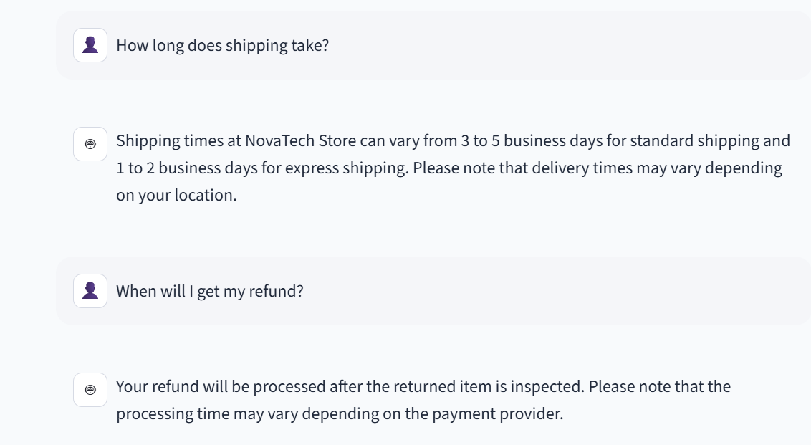

# 💬 NovaTech Support — AI Customer Support Agent

An AI-powered customer support chatbot built using Python, Streamlit, Ollama, and the Qwen 2.5 language model.

The application simulates an electronics store's customer support assistant, helping customers with product questions, shipping, returns, refunds, and other support inquiries.

## 📸 Chatbot Preview



## 🚀 Features

- AI-powered customer conversations using a locally running language model
- Knowledge-base-assisted answers for store policies
- Conversation history and contextual follow-up questions
- Customer budget and gaming-preference memory during a chat session
- Rule-based safeguards for stock availability, warranty information, and delivery promises
- Quick-question buttons for common inquiries
- AI connection status indicator
- Chat reset functionality
- Downloadable chat transcripts
- Customer question counter

## 🛠️ Technologies Used

- **Python** — Application logic
- **Streamlit** — Interactive web interface
- **Ollama** — Local language model runtime
- **Qwen 2.5 (3B)** — AI conversation model

## ⚙️ How to Run Locally

### 1. Clone the repository

```bash
git clone https://github.com/haronsafah782-hash/ai-customer-support-agent.git
cd ai-customer-support-agent


### 2. Create and activate a virtual environment

On Windows:

```powershell
python -m venv .venv
.venv\Scripts\Activate.ps1
```

### 3. Install Python dependencies

```bash
pip install -r requirements.txt
```

### 4. Install Ollama and download the model

Install Ollama from https://ollama.com.

Then run:

```bash
ollama pull qwen2.5:3b
```

Make sure Ollama is running.

### 5. Start the application

```bash
streamlit run app.py
```

Open the local Streamlit address shown in the terminal.

## 📁 Project Structure

```text
ai-customer-support-agent/
├── app.py
├── knowledge_base.txt
├── requirements.txt
├── README.md
├── .gitignore
└── .streamlit/
    └── config.toml
```

## 🔒 Limitations

- Requires Ollama and the Qwen model to run locally.
- Does not connect to a live inventory or order-tracking system.
- Does not confirm exact delivery dates, product stock, or undocumented warranty terms.
- Customer preferences are stored for the current application session, not in a permanent database.

## 🎯 Project Purpose

This project demonstrates practical skills in Python development, local LLM integration, prompt engineering, knowledge-base-assisted customer support, chatbot guardrails, session state management, and Streamlit application development.

## 📌 Future Improvements

- Live inventory and order-tracking integration
- Persistent customer conversation storage
- Automated testing and evaluation
- Cloud deployment with a suitable hosted model
